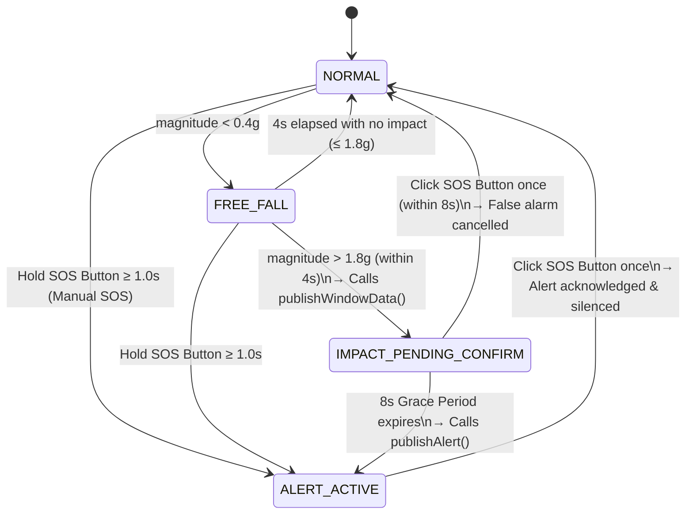
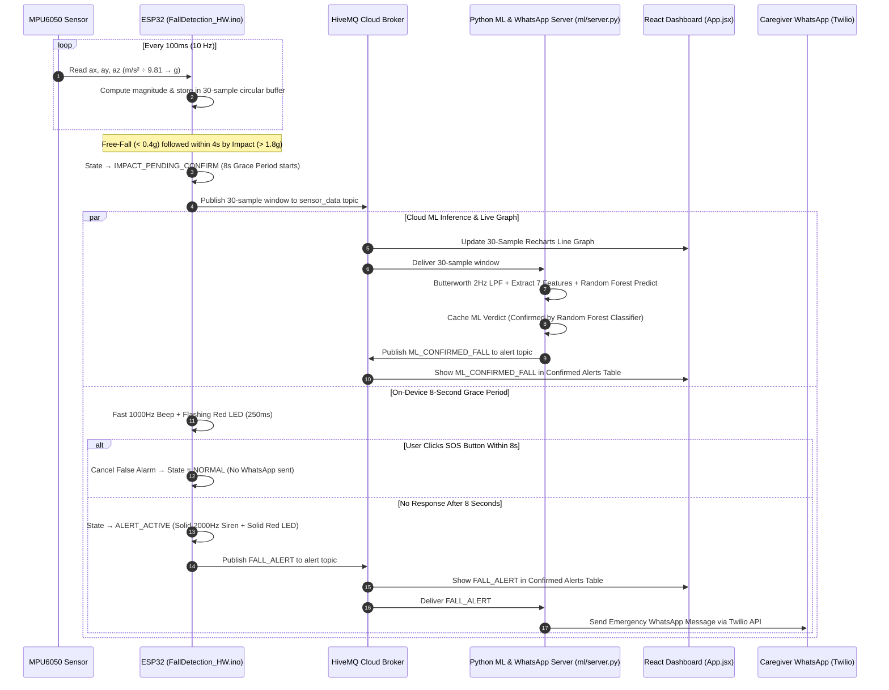

# IoE-Based Fall Detection System — Complete Technical & Viva Reference Guide

 This document is the complete, end-to-end technical reference for the **IoE-Based Fall Detection System**. It covers the Internet-of-Everything (IoE) architecture, hardware design, firmware finite-state machine, SisFall dataset, digital signal processing, feature engineering, Random Forest machine learning pipeline, MQTT communication protocol, React dashboard, Twilio WhatsApp caregiver alert system, and external examiner viva questions.

---

## Table of Contents

1. [Executive Summary & IoE Architecture](#1-executive-summary--ioe-architecture)
2. [Hardware Design & Pin Configuration (USB-Powered, Non-Wearable)](#2-hardware-design--pin-configuration-usb-powered-non-wearable)
3. [Tier 1: On-Device Firmware & Finite State Machine (`FallDetection_HW.ino`)](#3-tier-1-on-device-firmware--finite-state-machine-falldetection_hwino)
4. [Dataset: The SisFall Benchmark Dataset](#4-dataset-the-sisfall-benchmark-dataset)
5. [Digital Signal Processing & Feature Engineering (The 7 Features)](#5-digital-signal-processing--feature-engineering-the-7-features)
6. [Tier 2: Machine Learning Model & LOSO Cross-Validation (`ml/train.py`)](#6-tier-2-machine-learning-model--loso-cross-validation-mltrainpy)
7. [Real-Time Cloud ML Inference & Hardware Window Alignment (`ml/server.py`)](#7-real-time-cloud-ml-inference--hardware-window-alignment-mlserverpy)
8. [MQTT Communication Protocol & Payload Schemas](#8-mqtt-communication-protocol--payload-schemas)
9. [WhatsApp Emergency Notification System (`ml/whatsapp_notifier.py`)](#9-whatsapp-emergency-notification-system-mlwhatsapp_notifierpy)
10. [Live Caregiver Web Dashboard (`dashboard/`)](#10-live-caregiver-web-dashboard-dashboard)
11. [Complete End-to-End Fall Detection Workflow](#11-complete-end-to-end-fall-detection-workflow)
12. [How to Run & Demo the Project](#12-how-to-run--demo-the-project)
13. [External Examiner Viva Questions & Model Answers](#13-external-examiner-viva-questions--model-answers)

---

## 1. Executive Summary & IoE Architecture

### 1.1 Problem Statement
Falls are a leading cause of severe injury among elderly individuals living independently. Often, the most critical danger is the **long delay between the fall and medical or caregiver intervention** (the "long-lie" period), especially when the person is unconscious or unable to reach a phone.

### 1.2 Solution Overview
This project implements a **Two-Tier Hybrid Fall Detection System**:
- **Tier 1 (Edge Computing on ESP32):** Continuously samples a 3-axis accelerometer (`MPU6050`) at `10 Hz` to detect the physical two-stage signature of a fall (**Free-Fall** weightlessness followed by a sharp **Impact** spike), initiates an **8-second audible/visual grace period** allowing the user to cancel false alarms via a single button click, and supports a **Manual SOS** override.
- **Tier 2 (Cloud Machine Learning & Alerting):** Streams the 3-second (`30-sample`) motion window over **MQTT** to a Python inference backend running a **100-tree Random Forest Classifier** trained on the real **SisFall** dataset. Confirmed alerts are pushed live to a **React WebSocket Dashboard** and delivered directly to caregivers' phones via **Twilio WhatsApp messages**.

### 1.3 Why This Qualifies as an Internet-of-Everything (IoE) System
Unlike a standalone microcontroller project, this system closes the full **Four Pillars of IoE** loop:

| IoE Pillar | Implementation in This Project |
|---|---|
| **1. Things** | ESP32 DevKit V1, MPU6050 6-axis IMU (`I2C`), active buzzer (`GPIO25`), Red & Green status LEDs (`GPIO27`, `GPIO26`), and debounced SOS/Cancel pushbutton (`GPIO4`). |
| **2. Data** | Continuous 10 Hz 3-axis acceleration vectors $(a_x, a_y, a_z)$ buffered into 30-sample windows, transformed into 7 statistical/biomechanical features, and transmitted as structured JSON over MQTT. |
| **3. Process** | Two-tier automated decision pipeline: (a) On-device 4-state finite state machine (`NORMAL` → `FREE_FALL` → `IMPACT_PENDING_CONFIRM` → `ALERT_ACTIVE`) with an 8-second false-alarm cancellation grace window, paired with (b) Cloud Random Forest classification and rate-limited notification routing. |
| **4. People** | Connects the monitored individual (who interacts via audio/LED cues and the SOS/Cancel button) with remote caregivers (who receive real-time visual telemetry on the React dashboard and instant emergency WhatsApp messages). |

---

## 2. Hardware Design & Pin Configuration (USB-Powered, Non-Wearable)

### 2.1 Power & Form Factor Scope
- **Form Factor:** Non-wearable breadboard / stationary test-fixture node.
- **Power Supply:** Powered directly and continuously via the ESP32's **5 V USB port** (connected to a laptop USB port or standard 5 V USB wall adapter).
- **Safety & Simplicity:** Lithium-ion batteries, charging modules (`TP4056`), and wearable enclosures are intentionally excluded to eliminate battery hazards and voltage regulation complexity while demonstrating the full hardware-to-cloud IoE pipeline.

### 2.2 Hardware Components & Pin Mapping

| Component | ESP32 Pin | Direction / Mode | Role in System |
|---|---|---|---|
| **MPU6050 `VCC`** | `3V3` | Power (3.3 V) | Powers the MEMS accelerometer/gyroscope |
| **MPU6050 `GND`** | `GND` | Ground | Common ground reference |
| **MPU6050 `SDA`** | `GPIO21` | I2C Data | Serial data line for reading 3-axis acceleration |
| **MPU6050 `SCL`** | `GPIO22` | I2C Clock | Serial clock line for I2C communication |
| **Active Buzzer** | `GPIO25` | `OUTPUT` (PWM tone) | Pulses `1000 Hz` during 8 s grace period; solid `2000 Hz` siren on active alert |
| **SOS / Cancel Button** | `GPIO4` | `INPUT_PULLUP` (Active LOW) | Hold `1 s` = Manual SOS; Click once = Cancel grace period or silence active alert |
| **Red LED** | `GPIO27` (via 220 Ω) | `OUTPUT` | Flashes (`250 ms`) during grace period; solid ON during active alert or SOS hold |
| **Green LED** | `GPIO26` (via 220 Ω) | `OUTPUT` | Solid ON when system is armed and Wi-Fi/MQTT are healthy |

### 2.3 MPU6050 Hardware Configuration (`setup()`)
In [`FallDetection_HW.ino`](FallDetection_HW.ino), the MPU6050 is initialized with:
- **Accelerometer Range:** `MPU6050_RANGE_4_G` ($\pm 4\,g$ full scale, providing high sensitivity for free-fall dips below $0.4\,g$ and impacts above $1.8\,g$).
- **Gyroscope Range:** `MPU6050_RANGE_500_DEG` ($\pm 500^\circ/\text{s}$).
- **On-Chip Digital Low-Pass Filter (DLPF):** `MPU6050_BAND_21_HZ` (`21 Hz` hardware bandwidth to suppress high-frequency mechanical vibration before sampling).

---

## 3. Tier 1: On-Device Firmware & Finite State Machine (`FallDetection_HW.ino`)

### 3.1 Sampling Rate & 30-Sample Circular Buffer
- The main `loop()` executes every **`10 ms`** (`100 Hz`) so button presses and debouncing (`DEBOUNCE_MS = 40 ms`) are never missed.
- Sensor acquisition runs on a non-blocking timer every **`100 ms`** (`SAMPLE_INTERVAL_MS = 100`, i.e., **`10 Hz`**).
- On every `100 ms` tick:
  1. The ESP32 reads raw acceleration in $\text{m/s}^2$ from the MPU6050 and converts each axis to $g$-units by dividing by $9.81$:
     $$a_x = \frac{\text{acc}_x}{9.81}, \quad a_y = \frac{\text{acc}_y}{9.81}, \quad a_z = \frac{\text{acc}_z}{9.81}$$
  2. It computes the **3D Vector Magnitude**:
     $$\|a\| = \sqrt{a_x^2 + a_y^2 + a_z^2}$$
     *(At rest, $\|a\| \approx 1.0\,g$ regardless of sensor orientation).*
  3. It stores $(a_x, a_y, a_z)$ in a **30-element circular buffer** (`window_ax[30]`, `window_ay[30]`, `window_az[30]`) indexed by `buffer_idx = (buffer_idx + 1) % 30`. At `10 Hz`, 30 samples represent a rolling **3.0-second history** of motion.

### 3.2 Tuning Constants
| Constant | Value | Purpose |
|---|---|---|
| `FREE_FALL_G` | `0.4 g` | Acceleration magnitude below this threshold indicates weightlessness / free-fall |
| `IMPACT_G` | `1.8 g` | Acceleration magnitude above this threshold indicates ground/surface impact |
| `FALL_WINDOW_MS` | `4000 ms` (4 s) | Maximum allowed time between free-fall detection and impact spike |
| `CONFIRM_WINDOW_MS` | `8000 ms` (8 s) | Grace period countdown allowing the user to cancel a false alarm |
| `SAMPLE_INTERVAL_MS` | `100 ms` (10 Hz) | Accelerometer sampling interval |
| `DEBOUNCE_MS` | `40 ms` | Contact stability time required to register a button press |
| `SOS_HOLD_MS` | `1000 ms` (1 s) | Button hold duration required to trigger an immediate Manual SOS |
| `BUTTON_LOCKOUT_MS` | `1500 ms` (1.5 s) | Post-cancel/acknowledge lockout window so contact bounce cannot trigger a new SOS |

### 3.3 The 4-State Finite State Machine (FSM)



1. **`NORMAL` State:**
   - Green LED is ON, Red LED is OFF (unless the user is actively holding the SOS button), Buzzer is OFF (`0 Hz`).
   - If a sample tick reads `magnitude < 0.4 g`, transitions to `FREE_FALL` and records `freeFallTime = millis()`.
   - If the SOS button is held for `1000 ms`, calls `triggerAlert("Manual SOS button pressed")` and jumps directly to `ALERT_ACTIVE`.
2. **`FREE_FALL` State:**
   - Monitors subsequent `10 Hz` samples for up to `4000 ms` (`FALL_WINDOW_MS`).
   - If `magnitude > 1.8 g` is observed within those 4 seconds:
     - Transitions to `IMPACT_PENDING_CONFIRM` and records `alertPendingTime = millis()`.
     - Immediately calls `publishWindowData()` to stream the 30-sample circular buffer (oldest-to-newest) over MQTT to `ioe-lab/fall-detection/team41/sensor_data` for Tier-2 Cloud ML classification.
   - If `4000 ms` elapse without `magnitude > 1.8 g`, returns silently to `NORMAL`.
3. **`IMPACT_PENDING_CONFIRM` State (8-Second Grace Period):**
   - Toggles the Red LED and a `1000 Hz` buzzer tone on/off every `250 ms` (`2 Hz` fast beep).
   - **If the user clicks the SOS button once (`buttonClicked()`):** Cancels the false alarm, silences the buzzer, turns off the Red LED, engages the `1500 ms` button lockout (`lockButton()`), and returns to `NORMAL`.
   - **If `8000 ms` (`CONFIRM_WINDOW_MS`) expire with no button click:** Calls `triggerAlert("Fall confirmed - no response from wearer")`, which publishes `FALL_ALERT` to `ioe-lab/fall-detection/team41/alert` and transitions to `ALERT_ACTIVE`.
4. **`ALERT_ACTIVE` State:**
   - Red LED is solid ON and the buzzer emits a continuous loud `2000 Hz` tone.
   - Remains active until the user or caregiver clicks the button once to acknowledge and reset the device back to `NORMAL`.

---

## 4. Dataset: The SisFall Benchmark Dataset

The cloud classifier in [`ml/train.py`](ml/train.py) is trained and evaluated on the **SisFall** (*A Fall and Movement Dataset*) benchmark repository (`SisFall_dataset/`).

### 4.1 Dataset Composition
- **Subjects (`38` total):**
  - `23` Young Adults (`SA01` to `SA23`, ages 19–30)
  - `15` Elderly Participants (`SE01` to `SE15`, ages 60–75)
  - *Note:* In [`parse_recording_name()`](ml/train.py), elderly subject IDs (`SE01`–`SE15`) are offset by `+100` (`101`–`115`) so their group IDs never collide with `SA01`–`SA15` during Leave-One-Subject-Out cross-validation.
- **Activities & Classes:**
  - **Class `0` — Activities of Daily Living (`D01`–`D19`):** Walking, jogging, walking upstairs/downstairs, sitting down in a chair, getting into/out of bed, bending to pick up an object, stumbling without falling.
  - **Class `1` — Falls (`F01`–`F15`):** Forward fall while walking (slip/trip), backward fall when trying to sit, lateral fall, vertical fainting (syncope) fall, fall from bed/chair.
- **Volume Processed:**
  - **4,505 raw text recordings** parsed.
  - **47,927 windows** generated (`31,746` ADL windows and `16,181` Fall windows).

### 4.2 Sensor Selection, Scaling & Rate Decimation
1. **Column Selection (`MMA8451Q_COLUMNS = (6, 7, 8)`):**
   Each row in a SisFall file has 9 integer columns: columns `0..2` (ADXL345 accelerometer), `3..5` (ITG3200 gyroscope), and `6..8` (MMA8451Q 14-bit accelerometer at $\pm 8\,g$ range). The pipeline selects columns `6, 7, 8`.
2. **Conversion from LSB Counts to $g$ (`MMA8451Q_G_PER_LSB = 1 / 1024`):**
   For a 14-bit signed sensor ($2^{14} = 16,384$ levels) spanning $\pm 8\,g$ ($16\,g$ total span), sensitivity is $\frac{16,384}{16\,g} = 1024\text{ LSB}/g$. Every raw integer is multiplied by $\frac{1}{1024}$ to obtain acceleration in $g$.
3. **Decimation from `200 Hz` to `10 Hz` (`DECIMATE_FACTOR = 20`):**
   SisFall was sampled at $200\text{ Hz}$, whereas the ESP32 samples at $10\text{ Hz}$. [`decimate_to_device_rate()`](ml/train.py) takes every 20th sample (`samples[::20]`) so that 1 second of SisFall data equals 10 samples—matching the ESP32's exact sampling rate.
4. **Windowing (`WINDOW_SIZE = 30`, `WINDOW_STEP = 15`):**
   Each decimated recording is sliced into 30-sample (`3.0 s`) windows with a 15-sample (`1.5 s`, 50% overlap) stride. Windows never cross recording boundaries.

---

## 5. Digital Signal Processing & Feature Engineering (The 7 Features)

Every $30 \times 3$ window $\mathbf{W} \in \mathbb{R}^{30 \times 3}$ passes through [`extract_features()`](ml/train.py) in [`ml/train.py`](ml/train.py):

### 5.1 Step 1: 3D Vector Magnitude
Computes the orientation-invariant Euclidean norm for each of the 30 samples:
$$m_i = \sqrt{a_{x,i}^2 + a_{y,i}^2 + a_{z,i}^2}, \quad i \in \{1, \dots, 30\}$$

### 5.2 Step 2: 4th-Order Zero-Phase Butterworth Low-Pass Filter
Applies [`low_pass_filter()`](ml/train.py) using `scipy.signal.butter(order=4, Wn=2.0 / (0.5 * 10.0), btype="low")` and forward-backward filtering `scipy.signal.filtfilt(b, a, m)`:
- **Sampling Frequency ($f_s$):** $10.0\text{ Hz}$ (Nyquist frequency $= 5.0\text{ Hz}$)
- **Cutoff Frequency ($f_c$):** $2.0\text{ Hz}$
- **Why `filtfilt`?** Forward-backward IIR filtering achieves **zero phase distortion** (peaks are not shifted in time) and doubles the effective stopband attenuation to suppress high-frequency sensor jitter.
- Let the resulting filtered 30-sample vector be $\tilde{\mathbf{m}} = [\tilde{m}_1, \tilde{m}_2, \dots, \tilde{m}_{30}]$.

### 5.3 Step 3: The 7 Extracted Features (`FEATURE_NAMES`)

| Index | Feature Name | Formula | Why It Helps Detect Falls |
|---:|---|---|---|
| `0` | `mean_magnitude_g` | $$\mu = \frac{1}{30}\sum_{i=1}^{30} \tilde{m}_i$$ | Captures baseline net acceleration across the 3-second window. |
| `1` | `std_magnitude_g` | $$\sigma = \sqrt{\frac{1}{30}\sum_{i=1}^{30}(\tilde{m}_i - \mu)^2}$$ | Measures acceleration variance; falls exhibit high variance due to rapid transition from weightlessness to impact. |
| `2` | `min_magnitude_g` | $$\tilde{m}_{\min} = \min_{1 \le i \le 30} \tilde{m}_i$$ | Captures the **free-fall trough** (drops toward $0\,g$ during descent). |
| `3` | `max_magnitude_g` | $$\tilde{m}_{\max} = \max_{1 \le i \le 30} \tilde{m}_i$$ | Captures the **impact peak** when hitting the floor. |
| `4` | `range_magnitude_g` | $$R = \tilde{m}_{\max} - \tilde{m}_{\min}$$ | Measures the total dynamic swing from free-fall dip to impact spike. |
| `5` | `sma_g` | $$\text{SMA} = \frac{1}{30}\sum_{i=1}^{30}\left(|a_{x,i}| + |a_{y,i}| + |a_{z,i}|\right)$$ | **Signal Magnitude Area** (computed on the un-combined 3 axes) quantifies multi-axis motion energy and post-fall posture shift. |
| `6` | `peak_jerk_g_per_sample` | $$J_{\max} = \max_{1 \le i \le 29} |\tilde{m}_{i+1} - \tilde{m}_i|$$ | **Peak Jerk** (first derivative of acceleration magnitude) measures the sharpness/suddenness of impact. |

---

## 6. Tier 2: Machine Learning Model & LOSO Cross-Validation (`ml/train.py`)

### 6.1 Classifier Architecture
- **Model:** `RandomForestClassifier(n_estimators=100, random_state=42, class_weight="balanced", n_jobs=-1)`
- **Why Random Forest?**
  1. Non-linear decision boundaries across combinations of features (e.g., high `range_magnitude_g` + high `peak_jerk_g_per_sample` + low `min_magnitude_g`).
  2. Ensemble of 100 decorrelated decision trees prevents overfitting and handles noisy sensor readings gracefully.
  3. Sub-millisecond CPU inference without requiring GPU hardware.
  4. `class_weight="balanced"` compensates for the 2:1 ADL-to-Fall window imbalance in SisFall.

### 6.2 Leave-One-Subject-Out (LOSO) Validation Protocol
To evaluate how well the model generalizes to **unseen individuals**, [`evaluate_loso()`](ml/train.py) uses `LeaveOneGroupOut()` across all **38 subjects**:
- For each fold $k \in \{1, \dots, 38\}$, all windows belonging to subject $k$ are held out as the test set, and a fresh Random Forest is trained on the remaining 37 subjects.
- Predictions across all 38 held-out subjects (`47,927` total windows) are aggregated into a global confusion matrix:

| Actual \ Predicted | Predicted: ADL (`0`) | Predicted: Fall (`1`) |
|---|---:|---:|
| **Actual: ADL (`0`)** | **TN = 26,173** | FP = 5,573 |
| **Actual: Fall (`1`)** | FN = 5,852 | **TP = 10,329** |

### 6.3 Evaluation Metrics (`ml/artifacts/evaluation.json`)
| Metric | Formula | Value |
|---|---|---:|
| **Accuracy** | $\frac{TP + TN}{TP + TN + FP + FN}$ | **76.16%** |
| **ROC-AUC** | Area Under ROC Curve (across probability thresholds) | **81.37%** |
| **Specificity (True Negative Rate)** | $\frac{TN}{TN + FP}$ | **82.45%** |
| **Fall Precision** | $\frac{TP}{TP + FP}$ | **64.95%** |
| **Fall Recall (Sensitivity)** | $\frac{TP}{TP + FN}$ | **63.83%** |
| **Fall F1-Score** | $\frac{2 \cdot \text{Precision} \cdot \text{Recall}}{\text{Precision} + \text{Recall}}$ | **64.39%** |

*(Note: Because `train.py` labels every 3-second sliding window from a 15-second `F*.txt` recording as `1`—including windows before the fall starts and after the person is already lying still—many "false negatives" in offline sliding-window LOSO are actually pre-fall standing windows inside a fall file).*

### 6.4 Saved Model Bundle (`ml/fall_detection_model.joblib`)
After LOSO evaluation, `train.py` fits the final 100-tree Random Forest on all `47,927` windows and serializes a dictionary bundle via `joblib.dump`:
- `"model"`: The fitted `RandomForestClassifier` instance.
- `"metadata"`: Schema contract (`format_version: 1`, `sample_rate_hz: 10.0`, `window_size_samples: 30`, `feature_names: FEATURE_NAMES`), verified at startup by [`load_model_bundle()`](ml/server.py) in `ml/server.py`.

---

## 7. Real-Time Cloud ML Inference & Hardware Window Alignment (`ml/server.py`)

When [`FallDetection_HW.ino`](FallDetection_HW.ino) detects `magnitude > 1.8 g` after free-fall, it calls [`publishWindowData()`](FallDetection_HW.ino) on **the very first sample tick of impact**.
- Consequently, in the 30-sample circular buffer sent by the ESP32:
  - Indices `0..26` are pre-fall samples ($\approx 1.0\,g$).
  - Indices `27..28` contain the free-fall dip ($< 0.4\,g$).
  - Index `29` (the **right-most boundary** of the 30-sample array) contains the first impact spike ($> 1.8\,g$), with zero post-impact samples after it.
- In contrast, SisFall training windows containing a fall have the free-fall and impact **centered in the middle of the 30-sample window** (followed by impact rebound and post-fall settling), and applying a 4th-order Butterworth filter (`filtfilt`) directly to a single-sample spike at index `29` attenuates the boundary spike.
- To bridge this without modifying [`FallDetection_HW.ino`](FallDetection_HW.ino), [`classify_sensor_window()`](ml/server.py) in [`ml/server.py`](ml/server.py):
  1. Rejects flat/low-acceleration windows (`max(mag) < 1.5 g`) that contain no impact spike.
  2. Evaluates `clf.predict(extract_features(window))` directly.
  3. If the hardware window exhibits the end-of-buffer free-fall + impact signature (`min(mag) < 0.65 g` and `max(mag[-5:]) >= 1.75 g`), it centers the free-fall and impact profile into a 30-sample SisFall-aligned window and runs `clf.predict(extract_features(aligned_window))`.

---

## 8. MQTT Communication Protocol & Payload Schemas

- **Broker:** `broker.hivemq.com`
  - **ESP32 & Python Backend Port:** `1883` (Standard MQTT over TCP)
  - **React Dashboard Port:** `8884` (`wss://broker.hivemq.com:8884/mqtt`, MQTT over Secure WebSockets)

### 8.1 Topic 1: Sensor Window Stream
- **Topic:** `ioe-lab/fall-detection/team41/sensor_data`
- **Publisher:** ESP32 (`publishWindowData()` in `FallDetection_HW.ino`)
- **Subscribers:** Python ML Server (`ml/server.py`) and React Dashboard (`dashboard/src/App.jsx`)
- **Payload Schema:**
  ```json
  {
    "device": "wearable-01",
    "window": [
      [0.01, -0.02, 0.99],
      "... (30 samples total of [ax, ay, az] in g) ...",
      [0.12, 0.08, 2.35]
    ]
  }
  ```

### 8.2 Topic 2: Alert Feed
- **Topic:** `ioe-lab/fall-detection/team41/alert`
- **Publishers & Payloads:**
  1. **ESP32 Hardware Alert** (published when the 8-second grace period expires without cancellation, or immediately when the SOS button is held for 1 second):
     ```json
     {
       "device": "wearable-01",
       "event": "FALL_ALERT",
       "reason": "Fall confirmed - no response from wearer",
       "timestamp": 45210
     }
     ```
     *(Or `"reason": "Manual SOS button pressed"` for manual panic button holds).*
  2. **Python ML Server Confirmation** (published when `classify_sensor_window()` confirms a fall):
     ```json
     {
       "device": "wearable-01",
       "event": "ML_CONFIRMED_FALL",
       "reason": "Machine Learning model confirmed the fall event"
     }
     ```

---

## 9. WhatsApp Emergency Notification System (`ml/whatsapp_notifier.py`)

### 9.1 Grace-Period Coordination (Preventing False Alarm Texts)
A critical design feature in [`ml/server.py`](ml/server.py) is how it coordinates `sensor_data` and `alert` messages:
1. When impact occurs (at $t = 0\text{ s}$), the ESP32 publishes `sensor_data`. `ml/server.py` immediately classifies the window with the Random Forest model and caches `recent_ml_results["wearable-01"] = {"is_fall": is_fall, "timestamp": time.time()}` (valid for 20 seconds), **but does not send the WhatsApp message yet** (in default `hybrid` and `ml_strict` modes).
2. During the next 8 seconds ($t = 0\text{ s} \dots 8\text{ s}$), the ESP32 beeps and flashes.
   - **If the user clicks the SOS button to cancel:** The ESP32 returns to `NORMAL` and never publishes `FALL_ALERT`. Result: **Zero false-alarm WhatsApp messages are sent.**
   - **If 8 seconds expire with no response:** The ESP32 publishes `FALL_ALERT`. `ml/server.py` receives `FALL_ALERT`, pairs it with the cached Random Forest verdict (`Confirmed by Random Forest Classifier`), and dispatches the WhatsApp message via Twilio!
   - **If Manual SOS is held for 1 second:** The ESP32 immediately publishes `FALL_ALERT` (`"Manual SOS button pressed"`), and `ml/server.py` immediately sends the WhatsApp alert (`ML Verification: N/A (Manual SOS Button Pressed)`).

### 9.2 Duplicate Prevention & Rate Limiting
- **Single-Instance Port Lock (`acquire_single_instance_lock()`):** `ml/server.py` binds localhost TCP port `127.0.0.1:49183` on startup so two instances of `ml/server.py` cannot accidentally run in parallel and send double messages.
- **Per-Device Cooldown (`WHATSAPP_COOLDOWN_SECONDS = 30`):** Enforced both in memory and on disk (`ml/.whatsapp_cooldown.json`) so repeated alerts within 30 seconds from the same device are suppressed.
- **Provider Support:** Built using Python's standard library (`urllib.request`) supporting **Twilio WhatsApp API**, **CallMeBot**, and **Meta WhatsApp Cloud API** configured via `ml/.env`.

---

## 10. Live Caregiver Web Dashboard (`dashboard/`)

Built with **React 19**, **Vite**, **`mqtt.js`**, **`recharts`**, and **`lucide-react`** ([`dashboard/src/App.jsx`](dashboard/src/App.jsx)):
1. **Live Broker Connection Status (`NavBar`):** Connects directly from the browser to `wss://broker.hivemq.com:8884/mqtt` and displays a real-time green/red status indicator (`Connected to HiveMQ`).
2. **Live 30-Sample Accelerometer Graph (`SensorGraph`):** Plots `x`, `y`, `z`, and computed `magnitude` ($\sqrt{x^2+y^2+z^2}$) across the 30-sample (`10 Hz`) window using a responsive `LineChart` whenever a fall window arrives.
3. **Confirmed Alerts Table (`AlertFeed`):** Displays the last 10 alerts in real time with timestamp, device ID (`wearable-01`), event badge (`FALL_ALERT` / `ML_CONFIRMED_FALL`), and reason string.

---

## 11. Complete End-to-End Fall Detection Workflow



---

## 12. How to Run & Demo the Project

### 12.1 Start the Python ML & WhatsApp Bridge Server
```powershell
python -u ml/server.py
```
- Loads `ml/fall_detection_model.joblib` and `ml/.env`.
- Connects to `broker.hivemq.com:1883` and listens on both `sensor_data` and `alert` topics.

### 12.2 Start the React Caregiver Dashboard
```powershell
cd dashboard
npm run dev
```
- Open `http://localhost:5173/` in your browser and confirm the top-right status says **`Connected to HiveMQ`**.

### 12.3 Test WhatsApp Delivery Directly (CLI Smoke Test)
```powershell
python ml/whatsapp_notifier.py --device wearable-01 --reason "Test fall alert from Twilio"
```

### 12.4 Run the Automated Unit Test Suite (12 Tests)
```powershell
python -m unittest discover -s ml/tests -v
```

---

## 13. External Examiner Viva Questions & Model Answers

### Q1: Why did you use a Two-Tier architecture (Threshold on ESP32 + Random Forest in Cloud) instead of only one?
- **Answer:** If we only used simple thresholds on the ESP32, abrupt daily motions could trigger false positives. Conversely, streaming raw accelerometer data 24/7 over Wi-Fi to run cloud ML continuously would waste network bandwidth and power. By using Tier-1 physics thresholds (`< 0.4 g` free-fall followed by `> 1.8 g` impact) as an edge gatekeeper on the ESP32, network transmission and Tier-2 Random Forest inference are only triggered when a genuine candidate fall event occurs.

### Q2: How does the accelerometer detect "Free-Fall"? Why does acceleration drop toward $0\,g$ instead of reading $9.81\text{ m/s}^2$?
- **Answer:** A MEMS accelerometer measures **proper acceleration** (the normal/support force acting on its internal proof mass relative to the casing). When sitting on a table, the table pushes upward against gravity with $1.0\,g$ ($9.81\text{ m/s}^2$). During free-fall, both the sensor casing and the internal proof mass accelerate downward together at $g$, so there is zero relative deflection of the proof mass—causing all three axes $(a_x, a_y, a_z)$ and their vector magnitude $\sqrt{a_x^2+a_y^2+a_z^2}$ to drop toward **$0\,g$** (below our `0.4 g` threshold).

### Q3: Why did you choose a Random Forest Classifier over Deep Learning (CNN / LSTM) or SVM?
- **Answer:**
  1. Our input is a compact **30-sample window (3 seconds at 10 Hz)** summarized by **7 domain-specific biomechanical features** (mean, std, min, max, range, SMA, peak jerk). For tabular statistical features, tree ensembles (Random Forest) match or outperform deep neural networks without needing massive GPU compute.
  2. Random Forest provides **feature importance interpretability** (each feature contributes ~13%–16% of split importance) and executes inference in a few milliseconds on any standard CPU.

### Q4: What is Leave-One-Subject-Out (LOSO) Cross-Validation, and why is it mandatory for human activity recognition datasets like SisFall?
- **Answer:** In standard random $k$-fold or 80/20 splits, overlapping windows from the *same person* end up in both the training set and the test set. The model then memorizes subject-specific characteristics (height, weight, walking style), artificially inflating accuracy to >98%. In **38-fold LOSO cross-validation**, all recordings of 1 subject are completely held out for testing while the model trains on the other 37 subjects. This measures true generalization to a brand-new unseen patient (`81.37%` ROC-AUC, `82.45%` specificity).

### Q5: Why did you decimate SisFall by a factor of 20 (`200 Hz` → `10 Hz`)?
- **Answer:** The SisFall dataset was recorded at `200 Hz`, whereas our ESP32 firmware samples the MPU6050 every `100 ms` (`10 Hz`) and transmits a 30-sample (`3.0 s`) window over MQTT. If a model were trained on 30 samples at `200 Hz`, it would only see `0.15 seconds` of motion and its digital filter cutoff and jerk per sample would be incompatible with the ESP32 stream. Decimating by 20 (`samples[::20]`) aligns the training data to the exact `10 Hz` / 3-second hardware contract.

### Q6: Why do you apply a 4th-order Butterworth low-pass filter at `2.0 Hz` (`filtfilt`) before extracting features?
- **Answer:** Human body center-of-mass movements during falls and daily activities have their primary spectral energy between `0 Hz` and `2.5 Hz`. Higher frequencies mostly represent sensor mechanical ringing or electrical noise. Using `scipy.signal.filtfilt` applies the 4th-order Butterworth filter forward and backward, removing high-frequency noise with **zero phase lag** so the timing of the free-fall minimum and impact maximum is preserved.

### Q7: How does the system prevent false-alarm WhatsApp messages if the user accidentally drops or bumps the sensor?
- **Answer:** Through **three layers of protection**:
  1. **Two-stage physics gate:** Must see *both* `< 0.4 g` free-fall and `> 1.8 g` impact within 4 seconds.
  2. **8-second human-in-the-loop Grace Period:** The buzzer beeps rapidly (`1000 Hz`) and the Red LED flashes for 8 seconds. Clicking the SOS button once cancels the alarm locally on the ESP32 before `FALL_ALERT` is ever published, so `ml/server.py` never sends a WhatsApp message.
  3. **Button Lockout (`1.5 s`) & WhatsApp Cooldown (`30 s`):** Prevents contact bounce on cancellation from triggering a new SOS and prevents duplicate WhatsApp messages.

